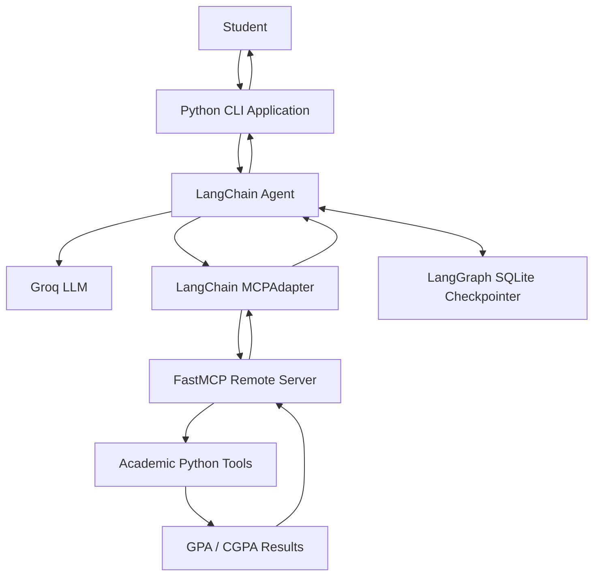

# 🎓 PUCIT GPA & CGPA Assistant

### An AI-powered academic advisor built with LangChain, LangGraph, FastMCP, and Groq

An intelligent, conversational GPA and CGPA assistant designed for PUCIT BS Computer Science students. The system combines an LLM-powered agent with a dedicated MCP server to perform academic calculations, retrieve course information, maintain persistent student conversations, and recover interrupted tool calls.

Instead of relying on an LLM to perform arithmetic itself, the assistant delegates calculations to dedicated Python tools, ensuring that academic results are produced through deterministic operations.

---

## ✨ Key Features

- **Conversational GPA Assistance:** Calculate semester GPA and projected CGPA through natural-language conversations.
- **Tool-Based Calculations:** Uses dedicated Python tools for every academic calculation instead of relying on LLM-generated arithmetic.
- **MCP Integration:** Exposes academic operations through a FastMCP server and connects them to the LangChain agent.
- **Remote MCP Deployment:** Connects to a remotely deployed FastMCP server.
- **OAuth Authentication:** Authenticates the remote MCP client using OAuth.
- **Persistent Conversation Memory:** Stores conversations in SQLite using LangGraph's asynchronous SQLite checkpointer.
- **Multiple Student Conversations:** Maintains separate conversation histories using individual thread IDs.
- **Conversation Management:** Switch between students, inspect chat history, and delete a student's conversation.
- **Streaming Responses:** Displays generated responses progressively instead of waiting for the entire answer.
- **Interrupted Tool-Call Recovery:** Detects incomplete tool calls in saved conversations and repairs them with corresponding error messages.
- **Idempotent Recovery:** Prevents already-repaired tool calls from receiving duplicate recovery messages.
- **Academic Domain Restrictions:** Restricts the assistant to PUCIT GPA, CGPA, courses, credit hours, and academic progress.

---

## 🏗️ System Architecture

The project separates the AI agent from the academic calculation services.

The agent handles conversation, reasoning, and tool selection, while the MCP server provides the actual academic operations.



### Component Responsibilities

| Component | Responsibility |
|---|---|
| Groq | Provides the language model used by the agent |
| LangChain | Creates the conversational agent and manages tool execution |
| LangGraph | Manages agent execution and checkpointed state |
| FastMCP | Exposes academic functions through the MCP protocol |
| MCPAdapter | Makes MCP tools available to LangChain |
| SQLite | Stores persistent conversation checkpoints |
| Python | Implements deterministic academic calculations |

---

## 🛠️ Technology Stack

| Technology | Purpose |
|---|---|
| Python | Application and calculation logic |
| LangChain | AI agent development |
| LangGraph | Agent execution and state persistence |
| FastMCP | MCP server and tool exposure |
| Groq | LLM inference |
| SQLite | Persistent conversation storage |
| aiosqlite | Asynchronous SQLite support |
| python-dotenv | Environment variable management |
| OAuth | Remote MCP authentication |

---

## 📁 Project Structure

```text
assignment01/
│
├── server/
│   ├── venv/
│   ├── server.py
│   ├── tools.py
│   └── requirements.txt
│
├── agent/
│   ├── venv/
│   ├── agent.py
│   ├── llm.py
│   ├── .env
│   ├── .env.example
│   ├── requirements.txt
│   ├── test_mcp.py
│   ├── test_gateway.py
│   ├── test_recovery.py
│   ├── test_recovery2.py
│   └── checkpoints.sqlite
│
├── .gitignore
└── README.md
```

**Important files:**

- `server/server.py` — Initializes the FastMCP server and registers academic tools.
- `server/tools.py` — Contains the academic calculation and information-retrieval functions.
- `agent/agent.py` — Main conversational application, agent configuration, streaming, conversation management, and recovery logic.
- `agent/llm.py` — Initializes the Groq language model.
- `agent/test_mcp.py` — Tests MCP tool discovery.
- `agent/test_gateway.py` — Tests remote MCP connectivity and OAuth authentication.
- `agent/test_recovery.py` — Tests recovery of an interrupted tool call.
- `agent/test_recovery2.py` — Tests multiple interrupted calls and duplicate prevention.

SQLite databases are generated at runtime and should not be committed with real conversation data.

---

## 🔧 Academic Tools

The FastMCP server exposes eight academic tools to the AI agent.

| Tool | Description |
|---|---|
| `marks_to_grade_points` | Converts examination marks into grade points |
| `calculate_semester_gpa` | Calculates semester GPA using course grade points and credit hours |
| `calculate_new_cgpa` | Calculates projected CGPA after adding a new semester |
| `required_gpa_for_target` | Determines the GPA required to achieve a target CGPA |
| `get_semester_courses` | Retrieves course information and credit hours for a semester |
| `get_remaining_credit_hours` | Retrieves remaining credit hours |
| `save_report` | Saves an academic calculation report when requested |
| `get_credit_hours` | Retrieves total credit hours for specified semesters |

### Academic Calculation Rules

The assistant follows the PUCIT BS(CS) grading and credit-hour rules configured in the academic tools.

- GPA calculations use course credit hours.
- Quran Translation carries 0.5 credit hours.
- Math Deficiency courses MD-001 and MD-002 are non-credit pass/fail courses and are excluded from GPA calculations.
- Missing marks or CGPA information are not invented.
- The LLM is instructed to use the appropriate tool for every numerical calculation.

### Progressive Target CGPA Planning

When a student asks what GPA is needed to reach a target CGPA, the agent follows a progressive horizon strategy.

Rather than immediately calculating across every remaining semester, it:

1. Starts with the current semester.
2. Evaluates the required GPA for that semester.
3. Expands the horizon one semester at a time if the target is not achievable.
4. Stops at the first horizon where the required GPA is achievable.
5. Presents the evaluated horizons and their results.

This approach provides students with a more practical understanding of their academic targets.

---

## 🧠 Persistent Memory and Conversation Management

The application uses LangGraph's `AsyncSqliteSaver` to persist agent conversation state.

Each student is assigned a separate thread ID.

This allows the application to:

- Preserve conversations across application restarts.
- Maintain separate histories for different students.
- Resume previous conversations.
- Inspect saved conversation messages.
- Delete an individual student's conversation when requested.

### Available Commands

| Command | Function |
|---|---|
| `/switch` | Switch to another student conversation |
| `/history` | Display the current student's conversation history |
| `/forget` | Delete the current student's saved conversation |
| `exit` | Exit the application |

The application stores conversation checkpoints in `checkpoints.sqlite`.

---

## 🔄 Interrupted Tool-Call Recovery

One of the important reliability features is the recovery mechanism for interrupted MCP tool calls.

### The Problem

During an MCP tool execution, the application may experience:

- Network disconnection
- MCP server interruption
- Application termination
- Unexpected execution failure

An interruption can leave a saved conversation containing an AI message with a tool call but no corresponding tool result.

This creates an incomplete tool-call sequence in the saved conversation.

### The Solution

The application implements `recover_interrupted_tool_calls()`.

Its recovery process:

1. Reads the saved conversation state from LangGraph.
2. Collects the IDs of existing `ToolMessage` objects.
3. Examines AI messages containing tool calls.
4. Identifies tool calls without corresponding results.
5. Creates an error `ToolMessage` with the matching tool-call ID.
6. Updates the saved conversation state through LangGraph.

### Idempotency

The recovery function tracks completed tool-call IDs using a Python set.

Before inserting a recovery message, it checks whether a result for that tool-call ID already exists.

Consequently, executing the recovery function repeatedly does not create duplicate recovery messages during normal sequential execution.

### Recovery Testing

The recovery mechanism was tested using both synthetic and real interrupted conversations.

| Test | Expected behavior | Result |
|---|---|---|
| Single interrupted tool call | Insert one error result | Passed |
| Two interrupted tool calls | Repair both calls | Passed |
| Recovery executed twice | Avoid duplicate results | Passed |
| Real interrupted MCP conversation | Repair missing tool result | Passed |
| Restart after recovery | Preserve repaired conversation | Verified |

**Important:** Recovery repairs conversation state. It does not automatically rerun the interrupted academic operation. The agent can continue after the incomplete tool-call sequence has been repaired.

---

## 🚀 Installation and Setup

### Prerequisites

- Python 3.11 or later (use a Python version supported by the installed dependencies)
- Git
- Groq API key
- Access to the deployed FastMCP server

### 1. Clone the Repository

```bash
git clone <YOUR_GITHUB_REPOSITORY_URL>
cd assignment01
```

### 2. Set Up the MCP Server

Navigate to the server directory:

```bash
cd server
```

Create a virtual environment:

```bash
python -m venv venv
```

Activate it on Windows:

```cmd
venv\Scripts\activate
```

Install dependencies:

```bash
pip install -r requirements.txt
```

Start the local MCP server:

```bash
python server.py
```

The server uses HTTP transport and listens on port 8000 by default. It also supports the `PORT` environment variable for deployment environments.

### 3. Set Up the AI Agent

Open another terminal and navigate to the agent directory:

```bash
cd agent
```

Create and activate a separate virtual environment:

```bash
python -m venv venv
venv\Scripts\activate
```

Install dependencies:

```bash
pip install -r requirements.txt
```

### 4. Configure Environment Variables

Create a `.env` file inside the `agent` directory.

Use the following structure:

```env
GROQ_API_KEY=your_groq_api_key
MCP_URL=https://pucit-cgpa-assistant.fastmcp.app/mcp
```

Replace `your_groq_api_key` with your own Groq API key.

**Never commit `.env` or expose API keys in your repository.**

### 5. Verify MCP Connectivity

Run:

```bash
python test_gateway.py
```

The client should authenticate with the remote MCP server, ping it, and discover the eight available tools.

The initial OAuth flow may require browser-based authentication.

### 6. Run the GPA Assistant

```bash
python agent.py
```

The application connects to the remote MCP server, discovers the academic tools, initializes the LangChain agent, and loads the persistent conversation checkpointer.

---

## 🧪 Running Tests

All test commands should be executed from the `agent` directory with its virtual environment activated.

### Test MCP Tool Discovery

```bash
python test_mcp.py
```

### Test Remote Gateway Authentication

```bash
python test_gateway.py
```

### Test Single Tool-Call Recovery

```bash
python test_recovery.py
```

### Test Multiple Tool Calls and Idempotency

```bash
python test_recovery2.py
```

The multiple-call recovery test verifies that two incomplete tool calls are repaired and that a second recovery execution does not create duplicate results.

---

## 🔐 Security and Configuration

- API keys are stored in environment variables rather than source code.
- `.env` should be excluded through `.gitignore`.
- `.env.example` provides a configuration template without real credentials.
- Remote MCP access uses OAuth authentication.
- SQLite stores persistent conversation data locally.

Before publishing the repository, verify that no API keys, OAuth tokens, private user data, or real conversation databases are committed.

---

## 💡 Example Use Cases

**Semester GPA calculation**

A student can ask:

> Calculate my semester 5 GPA. My marks are 85 in Artificial Intelligence, 80 in Analysis of Algorithms, and 75 in Human Computer Interaction.

The agent retrieves course credit hours, invokes the relevant grade-point and GPA tools, and presents the result.

**Target CGPA planning**

A student can ask:

> My current CGPA is 3.1. What GPA do I need to reach 3.4?

The agent requests any missing academic information and evaluates progressive semester horizons using the target-GPA calculation tool.

**Persistent conversations**

A student can exit the application, restart it, and continue using the same conversation name.

**Failure recovery**

If an MCP operation is interrupted, the application checks the saved conversation and repairs incomplete tool-call sequences before processing the next user request.

---

## 🎯 Project Objectives

This project demonstrates practical integration of:

- Large Language Models and tool-calling agents.
- Model Context Protocol (MCP).
- Remote server-client communication.
- OAuth-based authentication.
- Asynchronous Python programming.
- Persistent agent state and checkpointing.
- Streaming agent responses.
- Error handling and recovery.
- Idempotent state-repair operations.

The main objective is to build an AI assistant that does more than generate conversational answers: it delegates calculations to reliable tools, maintains state across sessions, and handles interrupted operations gracefully.

---


## 📜 Academic Project

Developed as part of an AI-focused university assignment exploring LangChain agents, MCP integration, persistent memory, and reliable agent execution.

